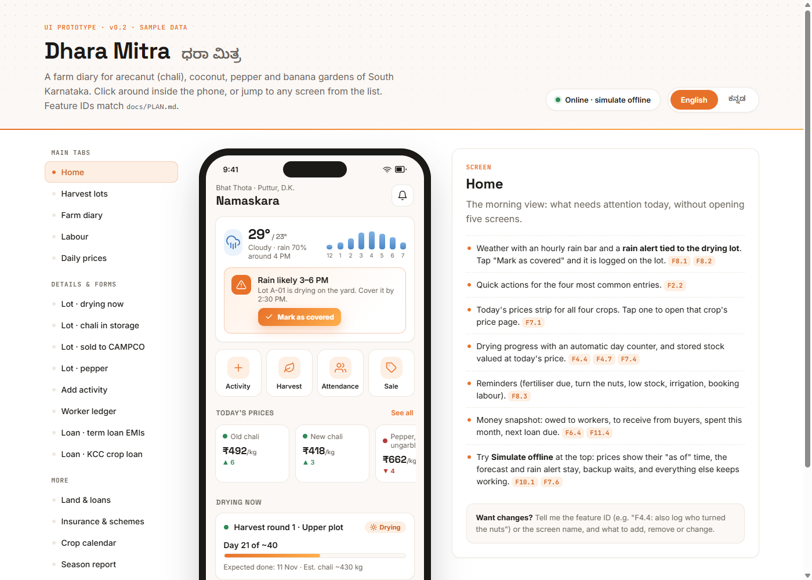
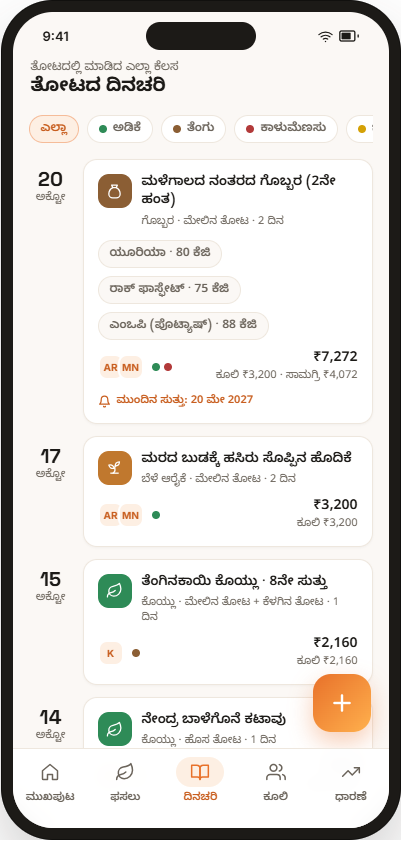

# Dhara Mitra · ಧರಾ ಮಿತ್ರ

**A Kannada and English farm diary for South Karnataka mixed gardens.**

[](https://github.com/Shr1ramN/Dhara-Mitra/actions/workflows/android.yml)
[](LICENSE)

Dhara Mitra means *friend of the earth*. It helps an owner record farm work, worker wages, harvests and money for arecanut, coconut, pepper and banana. Records are saved on the phone first, so everyday work does not depend on a network connection.

> **Development preview.** The expanded app is under active development. Financial workflows and device features still need final acceptance testing. Automatic market-price collection and Supabase cloud backup are not connected. See the [remaining-work checklist](https://github.com/Shr1ramN/Dhara-Mitra/issues/20) before relying on a feature.

## What is available

| Area | Implemented in the development app |
| --- | --- |
| Farm | Multiple isolated farms, map pin/GPS location, plots, crop details and season configuration |
| Diary | Work timeline, filters, notes, inputs from stock, labour and next-round reminders |
| Workers | Individual attendance work, reusable custom roles, validated Indian contact numbers, calling, rates, ledgers and dues |
| Harvest | Daily areca collections grouped or dried separately; bags until peeling or kg throughout; harvest → drying → peeling → grading → storage → sale; pepper, coconut/copra and banana lots; partial sales |
| Stock and money | Input purchases and usage, low-stock thresholds, buyers, receivables and expenses |
| Land and finance | Land records, loans and interest calculations, calculated membership holdings with editable purchases/dividends, insurance claims and scheme applications |
| Reports | Season totals, crop/plot breakdowns, yields, worker totals, PDF and Excel exports |
| Documents | Local files, photos, recorded voice notes and a document vault |
| Weather and tasks | Cached forecasts, rain log, reminders, crop calendar and notification scheduling |
| Privacy and backup | Optional device-authentication lock, per-farm backup/restore and all-farm backup/import with attachments |

The interface supports **ಕನ್ನಡ and English**, with fonts bundled for offline rendering. Prices can be entered manually, stored locally, charted and used for alerts. Live prices and some report/correction features remain tracked in [Issues](https://github.com/Shr1ramN/Dhara-Mitra/issues).

Daily labour in the diary, areca lots and other produce reuses one attendance wage per worker/date; separate piecework is additional. Enter `0.5` days for a half-day allocation. A shared day can be split between jobs without duplicating wages. Attendance corrections update linked lot costs and reports.

## Offline and online

Google/email sign-in and local mode are available in the app. Account sign-in needs
[Supabase configuration](docs/AUTHENTICATION.md). Signing in does not back up farm
records; all modes still require manual backups saved outside the app.

- **Offline:** record and review farm work, stock, harvests, sales, loans and documents; calculate balances; generate reports; create local backups.
- **Online:** refresh weather and eventually market prices. Previously cached data remains available offline. Sending a prepared report through another app may need connectivity.
- **Device dependent:** Kannada dictation may need internet unless the phone's speech service supports an installed offline language pack. Notifications and authentication depend on Android permissions and device support.
- **Pending:** automatic market-price imports/history collection and cloud backup/new-phone restore. No API key or cloud account is required to run the existing offline app.

## Everyday collection flow

The top-left leaf button opens Home from any feature. The header's Back button and Android Back return to the previous page, or to Home from a section's first screen. Dialogs close first. Android Back on Home keeps the usual exit behavior. Home shortcuts are grouped under **Farm tools**; balances appear under **Money**.

1. Choose the active farm in **My farms**. Each farm has independent workers, accounts, stock and attachments.
2. Open **Collected from farm**, record the date and bags (or kg), and leave quantity blank if not measured yet.
3. Select one pickup to dry separately, or several pickups to **Dry selected together**. Pickups with different units cannot be mixed.
4. In the drying lot, record the **dried bags brought home**. At peeling, record the actual peeled output in kg; storage bag counts are separate packaging.
5. Original pickups remain visible inside the lot. Edit their measured quantity later without creating another harvest. No fixed kg-per-bag conversion is assumed.

Workers and buyers are deliberately separate per farm. If the same person works on two farms in one day, enter only that farm's share of the work/rate; full-day attendance in both profiles is two independent wage bookings. Cross-farm shared payroll is not automatic.

The map uses OpenStreetMap with attribution and needs internet for map tiles. Location is optional, coordinates are never typed, and saved farm data remains offline. **Fertilizer** on Home opens the existing diary form with stock use, labour and reminders. Automated UPI payment handoff remains deferred in [#26](https://github.com/Shr1ramN/Dhara-Mitra/issues/26).

## Run the Android app

Use **Flutter 3.47.8 / Dart 3.13.7**, **JDK 17**, and the Android SDK. The exact Flutter version is also pinned in [CI](.github/workflows/android.yml). Use `develop` for the latest merged development app. Feature changes arrive through reviewed pull requests.

```sh
git clone --branch develop https://github.com/Shr1ramN/Dhara-Mitra.git
cd Dhara-Mitra/app
flutter doctor -v
flutter doctor --android-licenses
flutter pub get
flutter devices
flutter run -d <device-id>
```

Replace `<device-id>` with the ID printed by `flutter devices`. On a physical phone, enable USB debugging, connect a data-capable cable, unlock it and accept the debugging prompt. See the [development guide](docs/DEVELOPMENT.md) for Windows setup, code generation and troubleshooting.

## Build and check

Run from `app/`:

```sh
flutter analyze
flutter test
flutter build apk --debug
```

The debug APK is written to `app/build/app/outputs/flutter-apk/app-debug.apk` from the repository root. The [testing guide](docs/TESTING.md) explains the remaining acceptance checks and data-preservation steps.

## GitHub Actions APKs

Open [GitHub Releases](https://github.com/Shr1ramN/Dhara-Mitra/releases) and select a **Develop preview**. Download **dhara-mitra-v1.apk** under Assets directly to your phone—no ZIP extraction. Each preview identifies its source commit and includes `SHA256SUMS`.

Pull requests to `develop` or `master` run **Analyze and test** only. A push/merge to `develop` runs those checks, then builds and publishes a development pre-release. Feature-branch pushes do not build APKs. Both protected branches require the checks on an up-to-date PR, prohibit deletion/force pushes, and retain the existing one-review requirement. Only repository admins may bypass the rules.

The workflow runs analysis and tests before building. Although the APK uses Flutter's release build mode, **it is signed with a public, test-only development key**. Both local build types use that key for testing compatibility. Do not treat these artifacts as trusted production releases.

Before updating a phone, export a backup. An in-place update requires the same app ID, compatible signing certificate and a suitable version code. If Android rejects the update, check those first; uninstalling or clearing storage removes local records. See [release preparation](docs/RELEASING.md).

## Project guide

| Resource | Purpose |
| --- | --- |
| [Plan](docs/PLAN.md) | Accepted F1–F12 requirements and architecture; includes future work |
| [Implementation status](docs/IMPLEMENTATION_STATUS.md) | Current capabilities, limitations and validation status |
| [Development guide](docs/DEVELOPMENT.md) | Setup, commands and repository layout |
| [Testing guide](docs/TESTING.md) | Automated checks and phone acceptance checklist |
| [Contributing](CONTRIBUTING.md) | Issue and pull-request workflow |
| [Security](SECURITY.md) | Data handling, credentials and vulnerability reporting |
| [Work tracker](https://github.com/Shr1ramN/Dhara-Mitra/issues/20) | Remaining implementation, delivery and deferred work |
| [UI prototype](prototype/index.html) | Open locally in a browser; all numbers are sample data |

## Design preview

These images show the **design prototype**, not verified screenshots of the current Android app.

<p>
  
  
</p>

## License

Project code is available under the [MIT License](LICENSE). Bundled fonts retain their respective [Open Font License notices](app/assets/fonts/).
